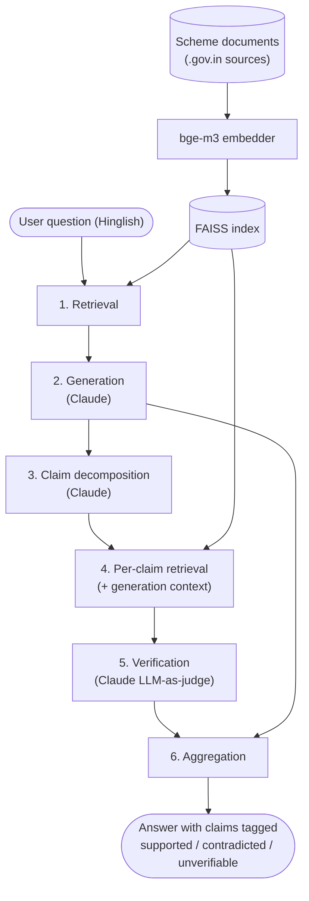
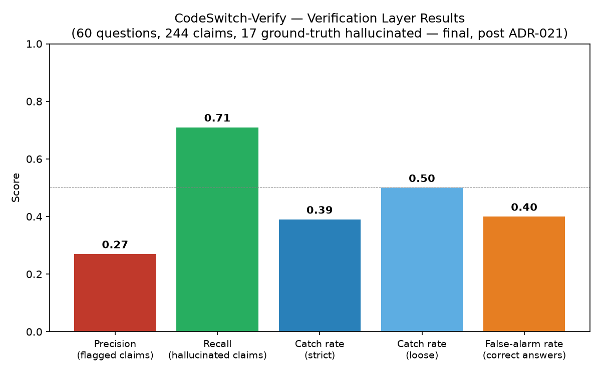

<div align="center">

# CodeSwitch-Verify

**Faithfulness-checked RAG for Hinglish government-scheme Q&A**

Every claim in every answer is checked against its source before it reaches the user.

[](LICENSE)
[](pyproject.toml)
[](tests)
[](https://d1zhxd8az51i27.cloudfront.net)

[**Try the live demo →**](https://d1zhxd8az51i27.cloudfront.net)

</div>

---

## The problem

RAG chatbots answering Hinglish (Hindi-English mixed) questions about Indian government schemes
generate fluent, confident answers — but nothing checks whether every individual claim in that
answer is actually supported by the source document. A wrong eligibility condition, a wrong
deadline, a wrong amount can pass straight through to the user, in a domain where being wrong has
real consequences.

CodeSwitch-Verify adds a claim-level verification layer *after* generation: every answer is
decomposed into atomic claims, each claim is checked independently against retrieved evidence, and
unsupported claims are flagged instead of trusted blindly.

## How it works



| Stage | What it does | Where |
|---|---|---|
| Retrieval | Embeds the question, finds the closest passages in the scheme documents | `src/retrieval.py` — bge-m3 + FAISS |
| Generation | Answers in Hinglish, grounded only in retrieved passages | `src/generation.py` — Claude Haiku 4.5 |
| Claim decomposition | Splits the answer into atomic, independently-checkable claims | `src/decomposition.py` — LLM-based, with a regex fallback |
| Per-claim retrieval | Builds each claim's evidence pool: generation's context merged with a fresh per-claim lookup | `src/verification.py` |
| Verification | Judges each claim — supported / contradicted / unverifiable, with a confidence score, by majority vote over 3 samples | `src/verification.py` — LLM-as-judge |
| Aggregation | Combines per-claim verdicts back into the displayed answer | `src/pipeline.py` |

Exact function signatures and data formats: [`docs/contracts.md`](docs/contracts.md).

## Results

60 evaluation questions, 244 decomposed claims, 17 ground-truth hallucinated claims — evaluated
against human-reviewed labels for the 18 answers that drive every answer-level metric
([ADR-022](docs/problems_and_decisions.md)).

| Metric | Value |
|---|---|
| Recall on hallucinated claims | **0.71** |
| Precision on flagged claims | 0.27 |
| Answer-level catch rate (strict) | 0.44 |
| Answer-level catch rate (loose) | 0.56 |
| False-alarm rate on correct answers | 0.39 |

<div align="center">

</div>

These numbers are the result of seven fixes across four debugging rounds — a genuine data
corruption bug, a retrieval design flaw, a shipped fix that regressed recall before being repaired
rather than reverted, and a confirmed LLM-judge non-determinism issue addressed with majority-vote
judging. Full story, including what went wrong and how each regression was diagnosed:
[`docs/problems_and_decisions.md`](docs/problems_and_decisions.md). Precision is the known
weak point — what specifically gets over-flagged and why is broken down in
[`docs/error_analysis.md`](docs/error_analysis.md).

## Live demo

**[d1zhxd8az51i27.cloudfront.net](https://d1zhxd8az51i27.cloudfront.net)** — ask a question in
Hinglish about PM-KISAN, Ayushman Bharat, Post-Matric Scholarship, or PM Awas Yojana, and see each
claim in the answer checked and tagged in real time.

React + FastAPI, deployed on AWS Lambda (container image) behind CloudFront, with provisioned
concurrency to keep response times fast. The live demo runs on Groq instead of Claude — a
deliberate, disclosed divergence from the evaluated pipeline above, made for the demo's
unpredictable public traffic and free-tier rate limits. Deployment notes: [`web/DEPLOY.md`](web/DEPLOY.md).

## Quick start

```bash
uv sync
cp .env.example .env            # add your Anthropic API key

uv run scripts/fetch_scheme_data.py   # fetch scheme facts from official .gov.in sources
uv run scripts/build_index.py         # build the FAISS index

uv run python -m pytest               # run the test suite
```

To try the Streamlit demo locally instead of the deployed version:

```bash
uv run streamlit run demo/app.py
```

## Project layout

```
config/         settings (model names, paths, API key loading)
src/            pipeline code — retrieval, generation, decomposition, verification, evaluation
scripts/        CLI entry points
tests/          unit tests
data/schemes/   one CSV per scheme, structured facts fetched live from official .gov.in sources
eval/           hand-labelled evaluation set (questions + ground-truth labels)
results/        pipeline outputs — generated answers, verifier results, computed metrics
demo/           local Streamlit demo
web/            production demo — React frontend + FastAPI backend, deployed on AWS
docs/           reports, decision log, contracts, error analysis, figures
```

## Documentation

- [`docs/report_architecture_and_implementation.md`](docs/report_architecture_and_implementation.md) — system architecture, implementation notes, tech stack
- [`docs/report_evaluation_and_results.md`](docs/report_evaluation_and_results.md) — evaluation methodology, results, limitations
- [`docs/error_analysis.md`](docs/error_analysis.md) — verifier mistakes reviewed in detail
- [`docs/problems_and_decisions.md`](docs/problems_and_decisions.md) — running decision log (every ADR and problem referenced above)
- [`docs/slides.md`](docs/slides.md) — presentation slides

## Tech stack

Python · bge-m3 · FAISS · Claude API (Anthropic) · Groq · FastAPI · React · Docker · AWS Lambda · CloudFront

## License

[MIT](LICENSE). See [`ACKNOWLEDGEMENTS.md`](ACKNOWLEDGEMENTS.md) for the research and tools this
project builds on.
